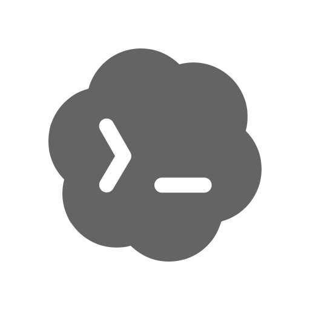

<div align="center">
  <p></p>
  <h1><code>SOAGENTS</code></h1>
</div>

<table>
  <tbody><tr><td align="center" width="99999"><div>
    <a href="https://olankens.com">WEBSITE</a> ·
    <a href="https://ko-fi.com/olankens">FUNDING</a>
  </div></td></tr></tbody>
  <tbody><tr><td align="center" width="99999">&nbsp;<div>
    Collection of practical AI agent skills that automate all software daily development tasks for Junie, Claude Code, and Codex to enable faster software deployment with better team collaboration results.
  </div>&nbsp;</td></tr></tbody>
  <tbody><tr><td align="center" width="99999">
    <a href="https://junie.jetbrains.com"></a>
    <picture></picture>
    <a href="https://claude.com/product/claude-code"></a>
    <picture></picture>
    <a href="https://openai.com/codex"></a>
  </td></tr></tbody>
</table>

## PREVIEWS

<table><tbody><tr><td width="99999">
  <picture></picture>
</td></tr></tbody></table>

## FEATURES

<table>
  <tbody><tr><td width="99999">Analyze repository structure and generate an accurate Markdown features table that highlights key project capabilities for clear team documentation inside any README file hosted on GitHub platform.</td><td>✅</td></tr></tbody>
  <tbody><tr><td>Examine source code patterns and write compact project descriptions that fit strict character limits for public visibility on the GitHub About page section helping software developers worldwide.</td><td>✅</td></tr></tbody>
</table>

## LEARNING

### UPDATE CLAUDE SKILLS

```shell
claude plugin marketplace add olankens/soagents
claude plugin install soagents@soagents
```

### UPDATE CODEX SKILLS

```shell
codex plugin marketplace add olankens/soagents
codex plugin marketplace upgrade soagents
codex plugin add soagents@soagents
```

### UPDATE JUNIE SKILLS

```shell
tempdir=$(mktemp -d)
git clone -q --depth 1 https://github.com/olankens/soagents.git "$tempdir/soagents"
mkdir -p "$HOME/.junie/skills"
cp -R "$tempdir/soagents/skills/." "$HOME/.junie/skills/"
```

### INSTALL COMMIT HOOK

```shell
mkdir -p "$(git rev-parse --git-path hooks)"
curl -fsSL 'https://raw.githubusercontent.com/olankens/subduing/HEAD/source/subduing.sh' -o "$(git rev-parse --git-path hooks)/commit-msg"
chmod +x "$(git rev-parse --git-path hooks)/commit-msg"
```

### REMOVE COMMIT HOOK

```shell
rm -f "$(git rev-parse --git-path hooks)/commit-msg"
```
